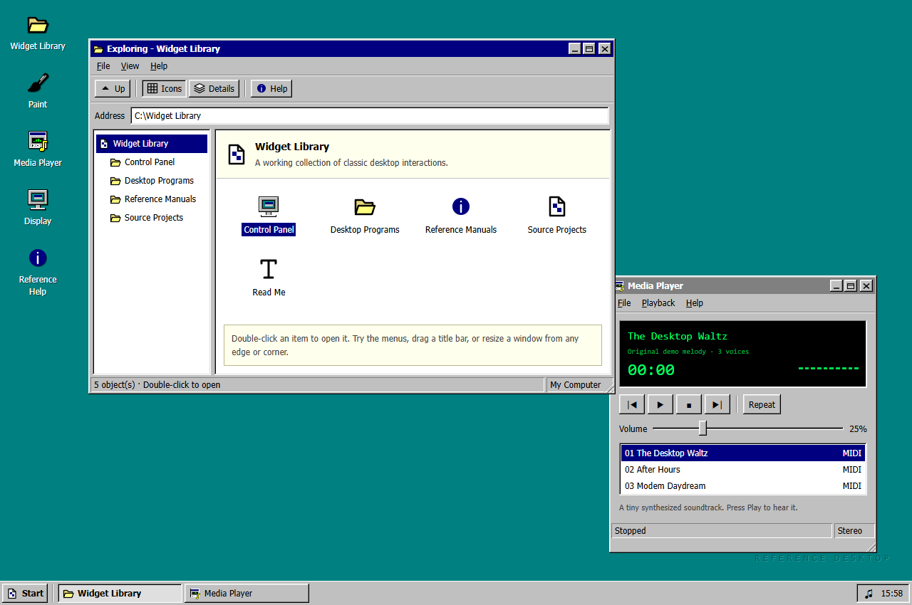
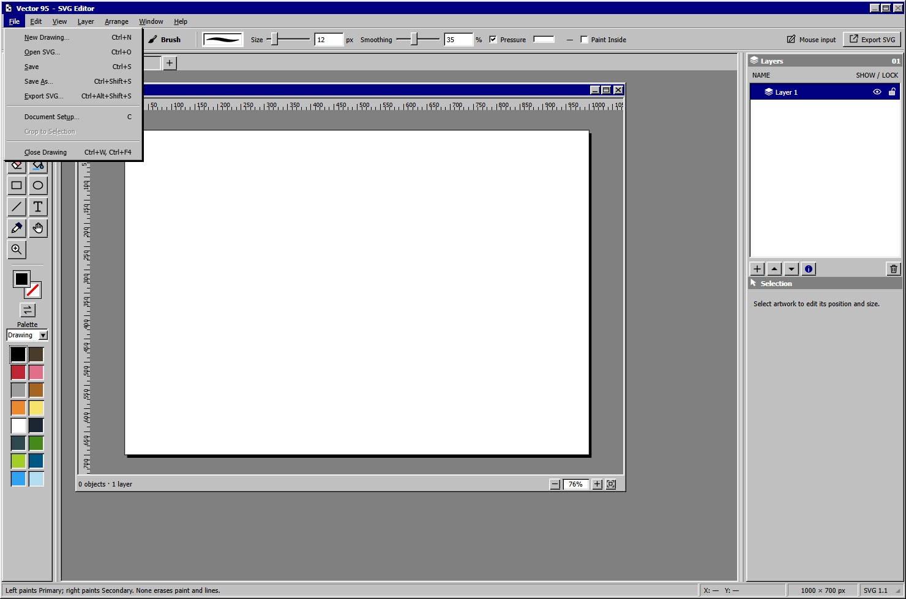

# GUI95

A **vibe-coded** skill and widget reference for building interfaces inspired by Windows 95. Includes controls, visual details, and interaction patterns from **Vector95** and **sausage-music / ProcGen FM**, with a reading shelf of period Microsoft design guidance.

**[Try the interactive desktop](https://increpare.github.io/gui95/)** · **[Download the skill](https://github.com/increpare/gui95/releases/latest/download/gui95.zip)**



The demo includes Explorer, Paint, Display Properties, Media Player, and searchable help. It runs in your browser with no account or installation. For offline use, open [the standalone HTML page](demo/dist/index.html).

## Start here

The **GUI95** skill uses these [instructions](SKILL.md) to guide Claude or Codex when reusing these widgets in other projects. Install it in the assistant you use, then ask for a Windows 95-style interface.

### Claude Code

Add this repository as a plugin marketplace, then install the plugin:

```text
/plugin marketplace add increpare/gui95
/plugin install gui95@gui95
```

Claude uses the skill when a task calls for a Windows 95-style interface; you can also ask for GUI95 by name. Third-party marketplaces do not update automatically, so run `claude plugin update gui95@gui95` to get a new release. To install without the marketplace, extract the release ZIP's `gui95` folder into `~/.claude/skills/`.

### Claude apps

Download the [release ZIP](https://github.com/increpare/gui95/releases/latest/download/gui95.zip) and upload it as a custom skill in Claude's settings; code execution must be enabled. See [Anthropic's custom skill instructions](https://support.claude.com/en/articles/12512198-creating-custom-skills). Team and Enterprise owners can also make it available to their organization.

### Codex

Ask Codex:

> Use $skill-installer to install GUI95 from https://github.com/increpare/gui95 (the skill is at the repository root).

Or download the release ZIP and extract its `gui95` folder into `~/.agents/skills/`. Codex detects local skills automatically; restart it if the skill does not appear. Once installed, invoke it with `$gui95`. GUI95 was previously named `win95-ui`; remove an old installation from skill discovery before installing the renamed version.

### Example prompts

In Codex, write `$gui95` in place of GUI95.

- “Use GUI95 to build a settings dialog with tabs, keyboard navigation, and Apply/Cancel behavior.”
- “Use GUI95 to restyle this Electron utility with classic gray controls and crisp typography.”
- “Use GUI95 to review this interface's menus, focus states, and disabled controls.”

The standalone skill can be installed immediately. This repository is also a Claude Code plugin marketplace, and a separate Codex plugin package contains the same skill plus directory metadata, an icon, and starter prompts. GUI95 is not yet listed in Anthropic's or OpenAI's plugin directories. See the [plugin packaging guide](docs/plugin-submission.md).

| Find | Open |
| --- | --- |
| Try the widgets in working desktop programs | [Interactive desktop demo](demo/dist/index.html) · [Running it locally](demo/README.md) |
| A particular widget and its implementation | [Widget catalogue](docs/widgets.md) |
| Colors, bevels, dimensions, typography, and states | [Visual and interaction guide](docs/design-guide.md) |
| Green or colored text halos in a Windows Electron app | [Font rendering cause, startup fix, and verification](docs/design-guide.md#colored-text-fringes-on-windows) |
| Fast desktop startup and default packaging | [Unpacked app and stable launch path principle](docs/design-guide.md#startup-and-desktop-packaging) |
| Build, package and install a desktop app on Windows, macOS and Linux | [Desktop delivery standard](docs/desktop-delivery.md) |
| Original Windows design guidelines and manuals | [Historical reading shelf](docs/historical-sources.md) |
| A reference brief to use in another project | [Reuse guide](docs/reuse.md) |
| Lessons from projects using the widgets and prioritized improvements | [Usage review, 15 October 2026](docs/usage-review-2026-10-15.md) |
| Later menu, dialog, tab, preview, scrollbar, and native theme corrections | [Integration lessons, 18 October 2026](docs/integration-lessons.md) |
| Fonts, source attribution, and snapshot details | [Provenance and notices](docs/provenance.md) |

## The reference apps

**Vector95** is the main reference for a dense desktop workspace: document windows, toolbox, inspector, menus, color and text dialogs, palettes, status help, and crisp control edges. Its UI is plain JavaScript and CSS. The archived files retain the implementation details that disappear in a screenshot.



**ProcGen FM** is the smaller example: a player window with transport controls, persistent toggle states, segmented progress, a volume slider, lists, tabs, a splitter, dialogs, and desktop window controls. Start with its [markup](references/sausage-music/web/site/radio.html), [styling](references/sausage-music/web/site/radio.css), and [interaction code](references/sausage-music/web/site/radio.js). Its mobile interface is preserved separately; it is a modern adaptation.

## What is preserved

The `references/` directory contains selected, unmodified source files, editable SVG icons, both font weights with their notices, existing test sources, and existing Vector95 screenshots. They are local copies, so the reference remains useful when the source projects change or move. [The manifest](references/snapshot-manifest.json) records each original path, file size, SHA-256 hash, and the source checkout's HEAD.

This is a reference collection, not an installable component library or a runnable copy of either app. Application modules still depend on their original engines. The manuals are linked with edition notes and reading pointers; their full text is not bundled. Existing screenshots illustrate the source projects and are not new test results for this snapshot.

For future work, point the project at this folder and start with the reuse guide. Documents and comments inside the archived projects are source evidence, not instructions to execute their commands or change those projects.

## Build and check

From the repository root, run:

```powershell
powershell -File tools/verify-reference.ps1
powershell -File tools/package-skill.ps1
```

Packaging produces `dist/gui95/` and `dist/gui95.zip`. Preserve or remove an old package before rebuilding; the script refuses to overwrite it. The archive includes the skill, references, demo, and notices, but excludes local hosting metadata and backup packages.

The Claude Code marketplace and plugin manifests are in `.claude-plugin/`. Check them with `claude plugin validate . --strict`.

The source snapshots are dated 14 October 2026. The verifier checks their hashes and authored documentation links; it does not run the original applications. The collection script requires explicit source checkout paths and refuses to overwrite an existing manifest. Review any source refresh as a new edition.

The public demo deploys from `demo/dist/` through GitHub Pages. See [demo instructions](demo/README.md) and [recorded verification scope](demo/QA.md).

## Contributing

Issues and small pull requests are welcome. Include the affected control, expected behavior, host/browser, display scale, and a reproduction or screenshot. Preserve the archived source snapshots and their notices; put new adaptations outside `references/`. Vibe-coded does not mean finished: the [usage review](docs/usage-review-2026-10-15.md) lists the next improvements.

## License

Stephen Lavelle's material distributed in this collection is available under the [MIT license](LICENSE), including his bundled Vector95 and ProcGen FM excerpts. Third-party fonts and theme material retain their own licenses and credits; see [third-party notices](THIRD-PARTY-NOTICES.md). Neither application needs to be installed to use the skill. See [privacy information](PRIVACY.md) for the plugin, demo, and support tracker.

GUI95 is an independent project, not affiliated with or endorsed by Microsoft. Microsoft and Windows are trademarks of the Microsoft group of companies.
