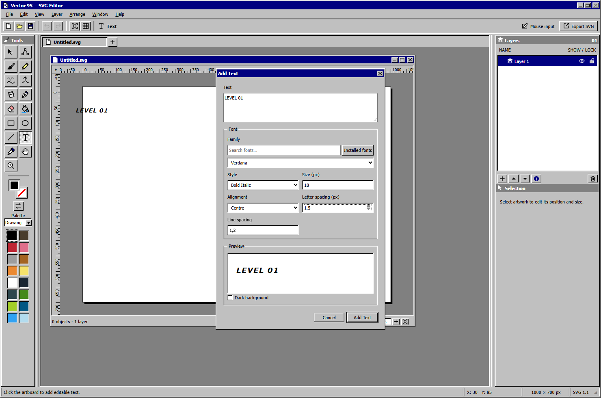

# Windows 95 visual and interaction guide

These are concrete patterns observed in the preserved projects. Pixel sizes describe their web implementations, not universal Windows 95 specifications. Consult the [historical shelf](historical-sources.md) when fidelity to a particular Windows release matters.

For fixes found in later consumer changelists, read the [integration lessons](integration-lessons.md): input and Undo ownership, safe conversion saves, nonlinear sliders, playback controls, streaming results, SVG stylesheet containment, dialog lifecycle and frameless captions, multi-row tabs, floating previews, scrollbar selectors, small-window action layouts, and native theme assets. Those adaptations do not change the archived edition.

The [recent integration lessons](recent-integration-lessons.md) cover embedded host layouts, shrinking grids and canvases, clipped tab joins and menus, accessible state marks, honest progress reporting and responsive readers, and (from 16 November) pressed controls that keep their size, selected-tab geometry, long result lists and consistent command names. Use them when those integration problems arise; a classic control palette does not require a simulated desktop around an embedded app.

## Color and dimensionality

Both projects use the same core colors. See Vector95's [`:root` declarations](../references/vector95/src/classic.css) and the [radio stylesheet](../references/sausage-music/web/site/radio.css).

| Role | Color | Application |
| --- | --- | --- |
| Control face | `#c0c0c0` | Windows, buttons, toolbars |
| Highlight | `#ffffff` | Lit edges and editable field backgrounds |
| Inner light edge | `#dfdfdf` | Second bevel step |
| Shadow | `#808080` | Recessed edges, inactive captions, disabled text |
| Dark edge and text | `#000000` | Outer shadow and normal text |
| Active caption and selection | `#000080` | White text on navy |
| Radio desktop | `#008080` | Space outside the player window |

### Which edge goes where

Windows 95 drew a two-line edge in four arrangements, and the kit's stylesheet has one recipe for each. Read top-left first, outer line then inner line:

| Surface | Top and left | Bottom and right | Kit recipe |
| --- | --- | --- | --- |
| Push buttons, caption buttons, tab pages | white, then light gray | black, then gray | `--gui95-raised` |
| Windows, dialogs, pop-up menus, scroll bar arrows and thumb, spin arrows | light gray, then white | black, then gray | `--gui95-raised-plain` |
| Text fields, list boxes, wells, check boxes | gray, then black | white, then light gray | `--gui95-sunken` |
| A held or latched push button | black, then gray | white, then light gray | `--gui95-pressed` |

The bottom and right lines are drawn last, so they own the top-right and bottom-left corner pixels of each line. A pressed default button is different again: its black frame stays, and inside it there is one gray line round a flat face, with no bevel.

These arrangements were taken on 18 November 2026 from the edge-drawing code of Wine and ReactOS, two independent reimplementations that agree with each other, and from the border diagram in Virginia Howlett's *Visual Interface Design for Windows* (figure 2.12); see the [bibliography](bibliography.md#source-code-you-can-read). They establish which colour role sits on which line. They do not establish Windows 95's exact light-gray value, for which the kit keeps `#dfdfdf`. Before this date the kit used the push-button edge for windows, dialogs and menus as well, let the top and left lines own the corners, and drew every pressed button with the field's sunken edge.

Raised controls put light edges at the top and left and dark edges at the bottom and right. Sunken fields reverse the relationship. The projects encode two edge depths, not a blurred shadow. Vector95 additionally uses layered linear gradients with exact 1 px and 2 px stops on its most visible buttons. Its later active-state rules are essential: copying only the opening CSS section loses the final appearance.

Use [Vector95 `classic.css`](../references/vector95/src/classic.css), search `--raised-lines`, `--sunken-lines`, and `.command-group button.active`. Use the radio's `--raised` and `--sunken` for the smaller inset-shadow implementation.

## Caption icons

Use the [shared caption controls](caption-controls.md) for new HTML title bars. The copyable stylesheet owns button dimensions, bevels and fixed pixel geometry for Minimize, Maximize, Restore and Close. Font characters such as an underscore or hollow square have different ink bounds and baselines; centering their text boxes does not produce consistent icons. This adaptation uses 18 × 18 buttons and a 10 × 10 icon canvas rather than changing the archived 16 × 14 patterns.

## Control states

| State | Visual treatment in the projects | Behavior to carry with it |
| --- | --- | --- |
| Resting button | Raised gray face | Clearly named command |
| Pressed button | Sunken edge; selected glyph rules move the image by a pixel | Feedback begins on press |
| Persistent tool or toggle | Sunken face with a 2 px white/gray checker pattern | State persists after release |
| Disabled button | Gray label with a white offset highlight | Use native `disabled`; suppress activation |
| Keyboard focus | Dotted inset outline | Keep focus distinct from selection |
| Selected list item | Navy background and white text | Maintain the actual selected value |
| Active window | Navy caption | Track which document or window receives commands |
| Inactive window | Gray caption | Keep its identity visible |

A toolbar mode and a momentary push button need different state handling. ProcGen FM expresses persistent states with `aria-pressed`; its tabs use `aria-selected`. Vector95 uses application state and active classes. Preserve the distinction even when the edges look similar.

Scope raised-button styling to command controls. An annotation marker, source citation, or processing message can use a quiet flat treatment within a reading surface. A semantic HTML `button` does not automatically need a bevel. Style the surrounding inspector coherently with gray faces, hard separators, square disclosures and readable text wells; review every feedback panel and its expanded states when adapting a theme. See the [reading-surface lessons](integration-lessons.md#reading-surfaces-type-size-and-control-roles).

The historical draft also describes border families and pressed, unavailable, focused, and option-set appearances. Use it to compare intent, with its prerelease status in mind: [Microsoft, February 1995, chapter 13](https://ics.uci.edu/~kobsa/courses/ICS104/course-notes/Microsoft_WindowsGuidelines.pdf#page=290).

## Typography and measurements

Vector95's current body rule uses **Tahoma, Microsoft Sans Serif, Arial**, at **11 px**. It bundles MS Sans Serif recreation fonts but does not select those fonts in its body rule. ProcGen FM defines **System95** from the bundled regular and bold WOFF2 files, using **11 px / 1.35** for body text. Both disable synthesized fonts. Do not infer Vector95's current typeface from an older screenshot.

| Element | Vector95 | ProcGen FM |
| --- | --- | --- |
| Main caption height | 20 px | 20 px |
| Caption button | 16 × 14 px | 16 × 14 px |
| General button minimum height | 23 px | 24 px |
| Text or number input | 23 px high | Consult control-specific rules |
| Checkbox | 13 × 13 px | Uses its own markup and native controls where applicable |
| Range thumb | 11 × 21 px | 11 × 21 px |
| Scrollbar width | 16 px | 16 px in the styled lists |
| Toolbar icon source | 16 × 16 viewBox | Transport glyphs displayed at 12 × 12 px |

Treat these as a coherent scale, not isolated magic numbers. Test enlarged text and display scaling. Keep readable labels and useful hit targets when adapting to touch. The radio's mobile interface is a separate adaptation, not evidence of 1995 phone design.

### Reading text and user sizing

**Period evidence:** Microsoft's February 1995 preliminary guide specifies 8-point MS Sans Serif for common interface text and requires adapting the interface to the user's chosen system fonts and metrics. Its accessibility section also discusses application zoom and testing enlarged system fonts. See [font and size, PDF page 298](https://ics.uci.edu/~kobsa/courses/ICS104/course-notes/Microsoft_WindowsGuidelines.pdf#page=298) and [accessibility, PDF pages 317–319](https://ics.uci.edu/~kobsa/courses/ICS104/course-notes/Microsoft_WindowsGuidelines.pdf#page=317). These are draft-era instructions, not a universal CSS font-size prescription.

**Implementation lesson, 18 October 2026:** Choose reading text for its apparent size and legibility in the intended host. CSS pixels, physical display pixels and points are different measures; Windows display scaling can compensate for higher DPI, and bitmap and outline fonts can differ at the same nominal size. Check the rendered text, including Latin diacritics, rather than treating a matching number as proof of readability.

Keep explanatory prose, dictionary entries and substantial feedback on a content type scale with a remembered text-size control. A consuming editor used 16px explanatory text, 14px secondary information and 20px serif dictionary text as larger defaults; those are an example adaptation, not required sizes for every app. Its View commands and keyboard shortcuts resized the content without changing document data or marking a document dirty. Keep captions, controls, counters and citation labels legible when they accompany that content.

Check content at twice its default size independently of 100%, 125%, 150% and 200% display scaling. Allow the panes to widen, wrap and scroll as needed. The [integration lessons](integration-lessons.md#small-windows-keep-the-next-action-reachable) cover grid tracks, saved split positions and unobscured footers.

### Colored text fringes on Windows

**Implementation note, 14 October 2026:** ProcGen FM showed greenish halos around black menu labels when its bundled System95 / MS Sans Serif recreation was rendered in Electron on Windows. The same symptom was subsequently reported in StreamTimer95, which selects the same recreation font. Vector95 uses native Tahoma for its UI instead; merely bundling the recreation files does not make Vector95 use them.

Chromium's LCD/subpixel text antialiasing gives the red, green, and blue channels different coverage at glyph edges. That can produce visible colored edges even when the CSS text color is pure black or white. Small bitmap-style outlines make this especially conspicuous. The recreation is delivered as a WOFF2 font and still goes through Chromium's font rasterizer; its pixel appearance does not disable antialiasing. Font choice, scaling, and the rendering path can change the appearance. Tahoma is an alternative if the project prefers Vector95's typography, but choosing it does not itself guarantee grayscale rendering.

For an Electron app using this font, set the Chromium switch in the **main process, before `app.whenReady()` and before creating any windows**:

```js
const { app } = require('electron');

// Avoid colored LCD text fringes on the bitmap-style UI font.
app.commandLine.appendSwitch('disable-lcd-text');

app.whenReady().then(() => {
    // Create the BrowserWindow here.
});
```

This selects grayscale text antialiasing rather than removing all antialiasing. It applies to the app's Chromium rendering; it does not require disabling GPU acceleration or changing Windows' system font settings. Because it is a startup setting, fully exit and relaunch the app. Reloading the renderer page is insufficient. For packaged applications, rebuild the package and launch the updated executable; rebuilding CSS alone cannot add a main-process setting.

**Do not rely on a CSS-only workaround:** `-webkit-font-smoothing` and `-moz-osx-font-smoothing` are macOS-specific controls. `text-rendering` is not a portable grayscale-antialiasing switch. An identity filter such as `filter: opacity(1)` appeared to remove the fringe in a software-rendered ProcGen FM check, but failed in the user's normal desktop app. It was removed when the Electron startup switch was added. An ordinary web page cannot set the host browser's Chromium startup switches.

**Verification evidence and procedure:** With the actual ProcGen FM Electron app and GPU compositing/rasterization enabled, a crop of the gray menu bar contained 810 pixels whose RGB channel spread exceeded 3 without the switch, and zero with it. This is a result for that specific menu crop, not a universal threshold for arbitrary screenshots. StreamTimer95's recurrence is reported; its fix has not been verified by this note. In each consuming app, inspect menu labels, regular and bold captions, buttons, input fields, lists, selected text, and dialogs at 100%, 125%, 150%, and 200% display scale. Use the actual desktop host and normal GPU path. Software-only or headless screenshots can produce different text rendering and are insufficient on their own. Confirm the startup switch with `app.commandLine.hasSwitch('disable-lcd-text')` and GPU status with `app.getGPUFeatureStatus()`.

The archived source files remain unchanged within this reference edition. Apply the setting in the consuming app; copying the preserved radio stylesheet does not carry this Electron fix with it.

Sources: [Chromium's `disable-lcd-text` switch](https://chromium.googlesource.com/chromium/src/+/HEAD/content/public/common/content_switches.cc), [Electron's command-line API](https://www.electronjs.org/docs/latest/api/command-line), and [CSS font-smoothing platform limits](https://developer.mozilla.org/en-US/docs/Web/CSS/Reference/Properties/font-smooth).

## Menus and keyboard ownership

[`createMenus`](../references/vector95/src/menus.js) is one of the most useful pieces to study. It opens a menu on pointer press, tracks movement across headings, supports dragging to a command, skips disabled entries, and restores prior focus. Keyboard handling includes Alt plus a heading letter, F10 by default, arrows, Home/End, Enter/Space, mnemonics, and Escape. Submenus can open to the left when space is tight.

The menu handles keyboard events in the capture phase while open and avoids taking over when a dialog is open. This prevents a letter intended for a menu from also switching the drawing tool. Its configurable menu key and command-search behavior are Vector95 extensions.

ProcGen FM's [`radio.js`](../references/sausage-music/web/site/radio.js) is a simpler alternative built around HTML `details` menus. Study `closeMenus`, `openMenu`, and the adjacent keyboard handlers. Do not assume it has all of Vector95's submenu and command-search features.

### File menu and recently opened files

**GUI95 default, 18 October 2026:** Apps that open and save files should provide recently opened files near the bottom of the **File** menu. Put ordinary file commands first (New, Open, Close, Save, Save As, and applicable import, export, or print commands), then a separator, a recent-files group, another separator, and **Exit** as the final item. Omit commands that do not apply to the app.

Prefer a short list directly in the File menu so each file takes one selection to reopen. A Recent Files submenu is also appropriate for long histories or distinct groups such as recent files and recent projects; keep the group in the same position above Exit. Use numeric access keys (`1`, `2`, and so on), with the most recently opened file first. Constrain long filenames to the available menu width with an ellipsis and retain the full path in a tooltip; one long entry must not push the whole menu offscreen. Do not put the group between Open and Save or append it below Exit. When the history is empty, use one disabled `(No recent files)` entry and keep the surrounding groups tidy.

**Historical basis and limits:** The [February 1995 preliminary interface guide, PDF page 108](https://ics.uci.edu/~kobsa/courses/ICS104/course-notes/Microsoft_WindowsGuidelines.pdf#page=108) explicitly places Exit last, preceded by a separator. Its [cascading-menu guidance, PDF page 114](https://ics.uci.edu/~kobsa/courses/ICS104/course-notes/Microsoft_WindowsGuidelines.pdf#page=114) permits submenus to save space, recommends using them sparingly, and advises against them for frequent, repetitive commands. Those sections do not prescribe an inline-versus-submenu rule for recent files.

Microsoft's [Office 95 compatibility checklist, updated January 1997](https://techshelps.github.io/MSDN/BACKGRND/html/msdn_win95app.htm), lists the most recently used list, a separator, and Exit in that order. This is Office 95 logo guidance, not a universal Windows requirement; the table does not explicitly distinguish inline entries from a submenu. [Microsoft Systems Journal, August 1999](https://jacobfilipp.com/MSJ/c0899.html), describes the ordinary MFC inline list and implements additional recent-file lists as submenus, citing Visual C++'s separate files/projects histories. Both forms occur in period Microsoft material. The preference for a short inline list is a GUI95 design choice, not a Microsoft prohibition on submenus. For a native macOS menu, retain the platform's application-menu Quit command.

Verify empty and populated history, newest-first ordering, numbered keyboard activation, and reopening through the normal file-open flow. Check that long filenames remain usable and Escape restores focus. This guidance does not change the archived menu implementations.

## Dialogs and fields

Use the [text dialog screenshot](../references/vector95/artifacts/layer-ui-checks/game-art-font-dialog.png) for grouping, compact labels, editable white fields, preview wells, and the primary action border. The source uses native `dialog` elements, including a transparent backdrop. A transparent backdrop still allows a dialog opened with `showModal()` to be modal.



Carry field labels, validation, keyboard focus, cancel behavior, and focus restoration into any extraction. Match the commit model to the task: a preview that changes immediately and a form that commits on OK are different interactions. The native dialog behavior and the application event handlers must be reviewed together.

## Dialog layout measures

Windows 95 dialogs were laid out in dialog units, not pixels. One horizontal unit is a quarter of the dialog font's average character width; one vertical unit is an eighth of its height. The kit's [dialog layout attributes](../kit/components/README.md#laying-out-a-dialog) apply the measures below, so use those attributes and do not copy the pixel values into your own rules.

**The pixel values are provisional.** They assume that 8-point MS Sans Serif at 96 dpi, which the kit's 11 px control text stands for, has a 6 × 13 px character cell. One horizontal unit is then 1.5 px and one vertical unit 1.625 px. This conversion was worked out on 18 November 2026 from the definition of the unit; it has not been checked against a running copy of Windows 95, and a real capture may correct it. The two units are declared once in `kit/components/gui95.css`, and every measure is derived from them.

| Measure | Kit | Final guidelines, 1995 | Howlett, figure 6.16 | File Manager templates |
| --- | --- | --- | --- | --- |
| Window edge to contents | 7 units, 11 px | 7 units "recommended" | 8 units, 12 px | Left 3 or 5, top 6, right 6, bottom 4 |
| Between controls | 4 units, 6 px | At least 4 units (the draft said 3) | 4 units, 6 px | Stacked buttons 3 units apart (34 cases), 6 (15) or 7 (5); buttons in a row 6 |
| Single-line control height | 14 units, 23 px | 14 units | 14 units, 22 px | All 111 buttons 14 units; most text fields 12 |
| Command button width | At least 50 units, 75 px; one width for the set | "A consistent length"; no number | 53 units, 80 px, the "default length" | 40 units (85 of 111 buttons), 50 (12) |
| Command button placement | A bottom row, right-aligned, or a right-hand column | A stack in the upper right corner or a row along the bottom; default button first; OK and Cancel together; Help last | Not stated | OK above Cancel in a right-hand column in all 23 dialogs that have both |
| Label directly above its field | 1 unit, 2 px | Labels go above or to the left; no gap given | Not stated | 1 unit (12 cases); to the left with a 2-unit gap (6) |
| Label beside its field | On the field's text line | "Align the height of the text with text displayed in the text box" | Not stated | Vertically centred |
| Group box, frame to contents | 6 units at the sides and bottom; first control 11 units below the top | Not given | Not given | Left 5 and top 11 units in 3 of 7 group boxes, bottom 3 in 2 (later master file only) |
| Property page size | 212 × 188, 227 × 215 or 252 × 218 units on request | Those three sizes, "recommended" | Not stated | None |
| Largest secondary window | Not enforced | 263 × 263 units (about 395 × 427 px) | Not stated | None |

Sources: *The Windows Interface Guidelines for Software Design* (Microsoft Press, 1995), chapter 13, "Font and Size", "Grouping and Spacing", "Alignment" and "Placement", with figures 13.23 and 13.24 (from printed page 385); Virginia Howlett, *Visual Interface Design for Windows* (1996), figure 6.16; and the dialog templates of Microsoft's File Manager (`winfile.USEnglish.rc`, Windows 3.1 resources, 36 dialogs and 111 push buttons). See the [period reading shelf](historical-sources.md) and the [bibliography](bibliography.md).

Where the sources disagree, and what the kit does:

- **Margin, 7 or 8 units.** The final guidelines recommend 7. Howlett's figure marks 8 units (12 px) at every edge, but it is a design prototype of Display Properties, not the shipped dialog. The kit uses 7.
- **Spacing, 3 or 4 units.** File Manager stacks its buttons 3 units apart and keeps 3 to 6 units at the window edge. That is Windows 3.1 practice, and 3 units was also the minimum in the February 1995 draft of the guidelines. The final book raised it to 4, and Howlett's figure agrees. The kit uses 4.
- **Button width, 40, 50 or 53 units.** File Manager's usual button is 40 units wide. Howlett's prototype marks 53. The final guidelines give no number. The kit keeps 50 units (75 px), the width it already used. No source on the period shelf gives that number, so treat it as the least well sourced of these measures.
- **Control height, 22 or 23 px.** Every source says 14 units. Howlett's figure converts that to 22 px because it uses about 1.5 px per unit in both directions. With a 1.625 px vertical unit it is 22.75 px, which the kit rounds to 23.
- **Row gap, 6 or 7 px.** Four vertical units are 6.5 px. The kit rounds down to 6, so that a control and its gap together come to 29 px, the nearest whole pixel to the 18-unit pitch of 29.25 px. Windows itself rounded each control's position separately, so real gaps were 6 or 7 px.

Three values are the kit's own choice, because no period source gives a number: the 7-unit space between a dialog's contents and its bottom button row (the guidelines say only to "use spacing between groups"), the group box's inner margins (the only evidence is seven group boxes in File Manager's later, NT-era template file), and the caption position in a group box, whose text starts 7 px from the frame's left edge as in Wine's reimplementation of the control.

Rules that go with the measures, all from the final guidelines: end a field's label with a colon, except on buttons, tabs and group boxes; top-align a check box or option button with a label of more than one line; keep buttons a consistent size, allowing one longer button only where matching it would greatly widen the set; and place a button that applies to one field beside that field.

## Density: period and comfortable sizes

GUI95 draws several controls larger than Windows 95 did. That is a choice, not an oversight: a larger menu command is easier to hit with a trackpad on a modern display. The kit therefore has two densities, chosen with `data-gui95-density` on the scope root or on any subtree:

- **`period`** is the authentic one. Its sizes are the ones a running copy of Windows 95 reported and drew.
- **`comfortable`** is the default, and what the kit drew before the switch existed. It stays the default so that existing applications do not change size, and because period targets are small by today's standards: a menu command is 17 px high and a list row 13 px, where current accessibility guidance asks for 24 px. The period density does not pad them invisibly; that would make it inauthentic.

Say which one an application uses. Do not describe a comfortable interface as pixel-accurate.

**Source of the period sizes.** A test program was run on Windows 95 4.00.1111 C (OSR2.5), installed from an original disc in an emulator, at 96 dpi with the default "Windows Standard" scheme, 640 × 480 in 24-bit colour, and captured on 19 November 2026. It recorded the system metrics and each control's rectangle, and the screen was saved as an image. The "Windows 95" column below is read from that report and from the pixels of those images. The kit columns were measured in Chromium at device scale 1.

| Control | Windows 95 | Kit, period | Kit, comfortable |
| --- | --- | --- | --- |
| Pop-up menu command, height | 17 | 17 | 22 |
| Pop-up menu margin inside the frame | 3 | 3 | 3 |
| Menu text, from the menu's outer edge | 24 | 24 | 26 |
| Menu text line (13 px) inside the command | 1 above, 3 below | 1 above, 3 below | Centred |
| Menu separator | 9 high; line 3 px down, the full width of the item | 9; 3 px down; full width | 8; 3 px down; 1 px short at each end |
| Menu check mark (7 × 7) | 6 from the item's left, 5 down | 6, 5 | 7, 7 |
| Menu option mark (6 × 6) | 7 from the item's left, 5 down | 7, 5 | 7, 8 |
| Submenu arrow (4 × 7) | 6 from the item's right, 4 down | 6, 4 | 7, 7 |
| Menu bar height (`SM_CYMENU`) | 19 | 19 | 22 |
| Menu bar heading | 18 high, flush with the bar's top and sides, headings touching | 18, flush, touching | 20, inset 1 px, 1 px apart |
| Title bar (`SM_CYCAPTION` 19) | An 18 px bar and one line of face colour under it | 18 and 1 | 20 and none |
| Title bar buttons | 16 × 14, 2 px from the top and from the right end | 16 × 14, 2 and 2 | 16 × 14, 3 and 3 |
| Title bar text line | 2 above, 3 below | 2 above, 3 below | Centred |
| Sizable window frame (`SM_CXFRAME`) | 4 | 4 (`.window`) | 3 |
| Dialog frame (`SM_CXDLGFRAME`) | 3 | 3 (`dialog`) | 3 |
| List box row | 13; text starts 1 px in | 13; 1 | 16.84; 3 |
| Drop-down list, closed | 21 (field 15, button 16 × 17) | 21 (15, 16 × 17) | 23 (17, 16 × 19) |
| Drop-down arrow (7 × 4) | 4 px from the button's left edge, 6 below the field's top | The same | 5 px from the left, centred |
| Option button | 12 × 12 artwork in a 13 × 13 box, at its top right | The same | 12 × 12 box |
| Check box | 13 × 13 | 13 × 13 | 13 × 13 |
| Command button; text field | 75 × 23; 23 high | 75 × 23; 23 | 75 × 23; 23 |
| Group box caption | Text starts 9 px from the frame's left; the frame is cleared 2 px each side of it | 9; 2 | 13; 4 |
| Scroll bar width | 16 | 16 | 16 |
| Status bar † | 20 high; panes 18, starting 2 px down, with no edge at the left, right or bottom | 20; 18; the same | 22.84; 18.84; 2 px edge all round |
| Tab † | 18 high; the selected tab 22, 2 px taller and 2 px over the page | 18; 22 | 20.84; 24.84 |
| Toolbar button ‡ | 24 × 22, related buttons edge to edge | 24 × 22, touching | 24 × 23, 2 px apart |

† **Era caveat.** OSR2.5 is the 1996 release. Its window manager and graphics files (`user.exe`, `gdi.exe`) carry version 4.0.0.950, the same as the August 1995 release, so menus, title bars, frames, list boxes, drop-down lists, buttons, group boxes and scroll bars are good evidence for 1995. Its common controls library is `comctl32.dll` 4.70, the 1996 version. The status bar and tab rows are therefore evidence for that library; the 1995 library may have differed and has not been measured.

‡ **Not measured.** The capture has no toolbar. The size is the one *The Windows Interface Guidelines for Software Design* (1995) gives for the smaller toolbar button, with its rule that related buttons are set edge to edge; Howlett (1996) says the button edges were designed to meet. Wine's toolbar control defaults to 23 × 22, one pixel narrower; the kit follows the published 24.

Compared with crops of the real screen, the period rendering of the pop-up menu, the menu bar, an active, an inactive and a dialog title bar, the list box, the closed drop-down list (at rest, with the focus and unavailable), the option button and the status bar has no differing pixel in any edge, frame, highlight, mark or arrow. Every difference that remains is inside the text, which the kit sets in a modern outline font where Windows used the MS Sans Serif bitmap font, or in the colour of the dotted focus rectangle (see below).

Not in the period density, and why:

- **Tool window caption.** Windows 95's small caption is 16 px (`SM_CYSMCAPTION`: a 15 px bar and a line). The kit has no tool-window title bar in either density.
- **Tree rows.** The capture has no tree and no other source gives a row height at better than low confidence, so trees are the same in both densities.
- **The fractional comfortable rows.** A comfortable list row is 16.84 px, a tab 20.84 and a status bar 22.84, because 11 px text at a line height of 1.35 is 14.85 px. Rounding them would move every later row, by more than a pixel after a few rows, so comfortable is left exactly as it was. The period density has no fractional height.

What the capture shows that is not a matter of size, and that the kit does not yet follow in either density:

- Inactive title bar text is the face colour, `#c0c0c0`. The kit draws it white.
- The focus rectangle on a selected list row is drawn by inverting pixels, so its dots are yellow (`#ffff7f`) on the navy bar; on a focused drop-down list they alternate yellow and black. The kit draws white dots.
- A group box's etched frame lies wholly inside the control's rectangle. The kit's reaches one pixel past it at the right and bottom.
- The group box caption in the dialog layout primitives (`fieldset[data-gui95-group]`) starts 7 px in with 1 px cleared, from an earlier reading of source code. The real one starts 9 px in with 2 px cleared, as the period density now draws a plain `fieldset`.

## Layout and icons

The compact appearance relies on `min-width: 0` and `min-height: 0` in nested flex/grid panes, deliberate scrolling, and separators made of light/dark lines. Removing those minimum-size rules can push a list or inspector outside its window.

Vector95 keeps editable [SVG icon sources](../references/vector95/src/assets/README.md), [caption glyphs](../references/vector95/src/assets/captions/close.svg), and [scroll arrows](../references/vector95/src/assets/scrollbars/up.svg). Its generated CSS supplies the arrow variables used by scrollbars. Include that dependency when extracting scrollbar styling. `icons.js` namespaces SVG IDs for each instance so gradients and clips do not collide across windows.

Monochrome icons can use `currentColor` to follow selection and disabled states. Fixed-color artwork remains fixed-color. Preserve the source viewBox and inspect the actual rendered size; a sharp icon at 16 px may look different at a fractional scale.

## Startup and desktop packaging

**Implementation principle, 14 October 2026:** Make an unpacked application the default desktop build and launch target. Keep its executable and runtime files together in a permanent folder, and offer a stable shortcut or executable path that does not change with the version number. File associations should open that unpacked executable directly.

Self-extracting packages perform extraction before the application can become usable. That repeated launch delay is an interaction cost: a convenient single file for transfer does not justify imposing it on every everyday launch. Keep self-extracting portable packages as an explicit distribution option rather than the default build, run command, shortcut, or file-association target.

Measure startup from the user's launch action through to a visible, usable window, including work performed by any launcher before the app process starts. Main-process or renderer timings alone can omit extraction and make a slow launch look fast. Test the actual default shortcut and an associated-file launch as well as the executable itself.

This principle was adopted in Vector95 after its portable package's opening delay became unacceptable. Its default build now produces an unpacked app and a stable shortcut; portable packaging is opt-in. Apply the principle in consuming apps while keeping the archived source snapshots unchanged. The [desktop delivery standard](desktop-delivery.md) turns it into one set of make targets, a compressed copy and a per-user install for Windows, macOS and Linux.

## Verification when reusing a pattern

Use the preserved tests as examples, not as a claim that an extracted control already passes. Vector95's [control polish test](../references/vector95/tests/ui/control-polish.spec.mjs) exercises display scales of 100%, 125%, 150%, and 200%, including press-and-drag menu behavior. Its [keyboard focus test](../references/vector95/tests/ui/keyboard-focus.spec.mjs) captures application-specific shortcut decisions; some deliberately give drawing shortcuts priority over a focused toolbar checkbox.

For a new app, check normal, pressed, latched, disabled, selected, and keyboard-focused states; pointer and keyboard activation; cancellation and restored focus; long labels; an empty list; narrow windows; and display scaling. Keep ordinary text-entry keys intact. Test native window controls in the intended desktop host, because browser imitations cannot establish desktop behavior.
