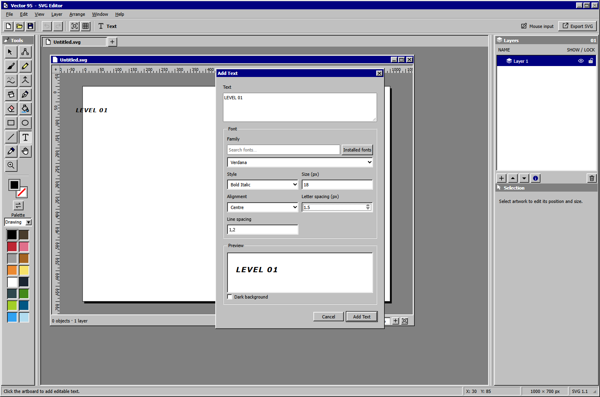

# Windows 95 visual and interaction guide

These are concrete patterns observed in the preserved projects. Pixel sizes describe their web implementations, not universal Windows 95 specifications. Consult the [historical shelf](historical-sources.md) when fidelity to a particular Windows release matters.

## Color and dimensionality

Both projects use the same core colors. See Vector95's [`:root` declarations](../references/vector95/src/classic.css) and the [radio stylesheet](../references/sausage-music/web/site/radio.css).

| Role | Color | Application |
| --- | --- | --- |
| Control face | `#c0c0c0` | Windows, buttons, toolbars |
| Highlight | `#ffffff` | Lit edges and editable field backgrounds |
| Inner light edge | `#dfdfdf` | Second bevel step |
| Shadow | `#808080` | Recessed edges, inactive captions, disabled text |
| Dark edge and text | `#000000` | Outer shadow and normal text |
| Active caption and selection | `#000080` | White text on navy |
| Radio desktop | `#008080` | Space outside the player window |

Raised controls put light edges at the top and left and dark edges at the bottom and right. Sunken fields reverse the relationship. The projects encode two edge depths, not a blurred shadow. Vector95 additionally uses layered linear gradients with exact 1 px and 2 px stops on its most visible buttons. Its later active-state rules are essential: copying only the opening CSS section loses the final appearance.

Use [Vector95 `classic.css`](../references/vector95/src/classic.css), search `--raised-lines`, `--sunken-lines`, and `.command-group button.active`. Use the radio's `--raised` and `--sunken` for the smaller inset-shadow implementation.

## Control states

| State | Visual treatment in the projects | Behavior to carry with it |
| --- | --- | --- |
| Resting button | Raised gray face | Clearly named command |
| Pressed button | Sunken edge; selected glyph rules move the image by a pixel | Feedback begins on press |
| Persistent tool or toggle | Sunken face with a 2 px white/gray checker pattern | State persists after release |
| Disabled button | Gray label with a white offset highlight | Use native `disabled`; suppress activation |
| Keyboard focus | Dotted inset outline | Keep focus distinct from selection |
| Selected list item | Navy background and white text | Maintain the actual selected value |
| Active window | Navy caption | Track which document or window receives commands |
| Inactive window | Gray caption | Keep its identity visible |

A toolbar mode and a momentary push button need different state handling. ProcGen FM expresses persistent states with `aria-pressed`; its tabs use `aria-selected`. Vector95 uses application state and active classes. Preserve the distinction even when the edges look similar.

The historical draft also describes border families and pressed, unavailable, focused, and option-set appearances. Use it to compare intent, with its prerelease status in mind: [Microsoft, February 1995, chapter 13](https://ics.uci.edu/~kobsa/courses/ICS104/course-notes/Microsoft_WindowsGuidelines.pdf#page=290).

## Typography and measurements

Vector95's current body rule uses **Tahoma, Microsoft Sans Serif, Arial**, at **11 px**. It bundles MS Sans Serif recreation fonts but does not select those fonts in its body rule. ProcGen FM defines **System95** from the bundled regular and bold WOFF2 files, using **11 px / 1.35** for body text. Both disable synthesized fonts. Do not infer Vector95's current typeface from an older screenshot.

| Element | Vector95 | ProcGen FM |
| --- | --- | --- |
| Main caption height | 20 px | 20 px |
| Caption button | 16 × 14 px | 16 × 14 px |
| General button minimum height | 23 px | 24 px |
| Text or number input | 23 px high | Consult control-specific rules |
| Checkbox | 13 × 13 px | Uses its own markup and native controls where applicable |
| Range thumb | 11 × 21 px | 11 × 21 px |
| Scrollbar width | 16 px | 16 px in the styled lists |
| Toolbar icon source | 16 × 16 viewBox | Transport glyphs displayed at 12 × 12 px |

Treat these as a coherent scale, not isolated magic numbers. Test enlarged text and display scaling. Keep readable labels and useful hit targets when adapting to touch. The radio's mobile interface is a separate adaptation, not evidence of 1995 phone design.

### Colored text fringes on Windows

**Implementation note, 14 October 2026:** ProcGen FM showed greenish halos around black menu labels when its bundled System95 / MS Sans Serif recreation was rendered in Electron on Windows. The same symptom was subsequently reported in StreamTimer95, which selects the same recreation font. Vector95 uses native Tahoma for its UI instead; merely bundling the recreation files does not make Vector95 use them.

Chromium's LCD/subpixel text antialiasing gives the red, green, and blue channels different coverage at glyph edges. That can produce visible colored edges even when the CSS text color is pure black or white. Small bitmap-style outlines make this especially conspicuous. The recreation is delivered as a WOFF2 font and still goes through Chromium's font rasterizer; its pixel appearance does not disable antialiasing. Font choice, scaling, and the rendering path can change the appearance. Tahoma is an alternative if the project prefers Vector95's typography, but choosing it does not itself guarantee grayscale rendering.

For an Electron app using this font, set the Chromium switch in the **main process, before `app.whenReady()` and before creating any windows**:

```js
const { app } = require('electron');

// Avoid colored LCD text fringes on the bitmap-style UI font.
app.commandLine.appendSwitch('disable-lcd-text');

app.whenReady().then(() => {
    // Create the BrowserWindow here.
});
```

This selects grayscale text antialiasing rather than removing all antialiasing. It applies to the app's Chromium rendering; it does not require disabling GPU acceleration or changing Windows' system font settings. Because it is a startup setting, fully exit and relaunch the app. Reloading the renderer page is insufficient. For packaged applications, rebuild the package and launch the updated executable; rebuilding CSS alone cannot add a main-process setting.

**Do not rely on a CSS-only workaround:** `-webkit-font-smoothing` and `-moz-osx-font-smoothing` are macOS-specific controls. `text-rendering` is not a portable grayscale-antialiasing switch. An identity filter such as `filter: opacity(1)` appeared to remove the fringe in a software-rendered ProcGen FM check, but failed in the user's normal desktop app. It was removed when the Electron startup switch was added. An ordinary web page cannot set the host browser's Chromium startup switches.

**Verification evidence and procedure:** With the actual ProcGen FM Electron app and GPU compositing/rasterization enabled, a crop of the gray menu bar contained 810 pixels whose RGB channel spread exceeded 3 without the switch, and zero with it. This is a result for that specific menu crop, not a universal threshold for arbitrary screenshots. StreamTimer95's recurrence is reported; its fix has not been verified by this note. In each consuming app, inspect menu labels, regular and bold captions, buttons, input fields, lists, selected text, and dialogs at 100%, 125%, 150%, and 200% display scale. Use the actual desktop host and normal GPU path. Software-only or headless screenshots can produce different text rendering and are insufficient on their own. Confirm the startup switch with `app.commandLine.hasSwitch('disable-lcd-text')` and GPU status with `app.getGPUFeatureStatus()`.

The archived source files remain unchanged within this reference edition. Apply the setting in the consuming app; copying the preserved radio stylesheet does not carry this Electron fix with it.

Sources: [Chromium's `disable-lcd-text` switch](https://chromium.googlesource.com/chromium/src/+/HEAD/content/public/common/content_switches.cc), [Electron's command-line API](https://www.electronjs.org/docs/latest/api/command-line), and [CSS font-smoothing platform limits](https://developer.mozilla.org/en-US/docs/Web/CSS/Reference/Properties/font-smooth).

## Menus and keyboard ownership

[`createMenus`](../references/vector95/src/menus.js) is one of the most useful pieces to study. It opens a menu on pointer press, tracks movement across headings, supports dragging to a command, skips disabled entries, and restores prior focus. Keyboard handling includes Alt plus a heading letter, F10 by default, arrows, Home/End, Enter/Space, mnemonics, and Escape. Submenus can open to the left when space is tight.

The menu handles keyboard events in the capture phase while open and avoids taking over when a dialog is open. This prevents a letter intended for a menu from also switching the drawing tool. Its configurable menu key and command-search behavior are Vector95 extensions.

ProcGen FM's [`radio.js`](../references/sausage-music/web/site/radio.js) is a simpler alternative built around HTML `details` menus. Study `closeMenus`, `openMenu`, and the adjacent keyboard handlers. Do not assume it has all of Vector95's submenu and command-search features.

## Dialogs and fields

Use the [text dialog screenshot](../references/vector95/artifacts/layer-ui-checks/game-art-font-dialog.png) for grouping, compact labels, editable white fields, preview wells, and the primary action border. The source uses native `dialog` elements, including a transparent backdrop. A transparent backdrop still allows a dialog opened with `showModal()` to be modal.



Carry field labels, validation, keyboard focus, cancel behavior, and focus restoration into any extraction. Match the commit model to the task: a preview that changes immediately and a form that commits on OK are different interactions. The native dialog behavior and the application event handlers must be reviewed together.

## Layout and icons

The compact appearance relies on `min-width: 0` and `min-height: 0` in nested flex/grid panes, deliberate scrolling, and separators made of light/dark lines. Removing those minimum-size rules can push a list or inspector outside its window.

Vector95 keeps editable [SVG icon sources](../references/vector95/src/assets/README.md), [caption glyphs](../references/vector95/src/assets/captions/close.svg), and [scroll arrows](../references/vector95/src/assets/scrollbars/up.svg). Its generated CSS supplies the arrow variables used by scrollbars. Include that dependency when extracting scrollbar styling. `icons.js` namespaces SVG IDs for each instance so gradients and clips do not collide across windows.

Monochrome icons can use `currentColor` to follow selection and disabled states. Fixed-color artwork remains fixed-color. Preserve the source viewBox and inspect the actual rendered size; a sharp icon at 16 px may look different at a fractional scale.

## Startup and desktop packaging

**Implementation principle, 14 October 2026:** Make an unpacked application the default desktop build and launch target. Keep its executable and runtime files together in a permanent folder, and offer a stable shortcut or executable path that does not change with the version number. File associations should open that unpacked executable directly.

Self-extracting packages perform extraction before the application can become usable. That repeated launch delay is an interaction cost: a convenient single file for transfer does not justify imposing it on every everyday launch. Keep self-extracting portable packages as an explicit distribution option rather than the default build, run command, shortcut, or file-association target.

Measure startup from the user's launch action through to a visible, usable window, including work performed by any launcher before the app process starts. Main-process or renderer timings alone can omit extraction and make a slow launch look fast. Test the actual default shortcut and an associated-file launch as well as the executable itself.

This principle was adopted in Vector95 after its portable package's opening delay became unacceptable. Its default build now produces an unpacked app and a stable shortcut; portable packaging is opt-in. Apply the principle in consuming apps while keeping the archived source snapshots unchanged.

## Verification when reusing a pattern

Use the preserved tests as examples, not as a claim that an extracted control already passes. Vector95's [control polish test](../references/vector95/tests/ui/control-polish.spec.mjs) exercises display scales of 100%, 125%, 150%, and 200%, including press-and-drag menu behavior. Its [keyboard focus test](../references/vector95/tests/ui/keyboard-focus.spec.mjs) captures application-specific shortcut decisions; some deliberately give drawing shortcuts priority over a focused toolbar checkbox.

For a new app, check normal, pressed, latched, disabled, selected, and keyboard-focused states; pointer and keyboard activation; cancellation and restored focus; long labels; an empty list; narrow windows; and display scaling. Keep ordinary text-entry keys intact. Test native window controls in the intended desktop host, because browser imitations cannot establish desktop behavior.
