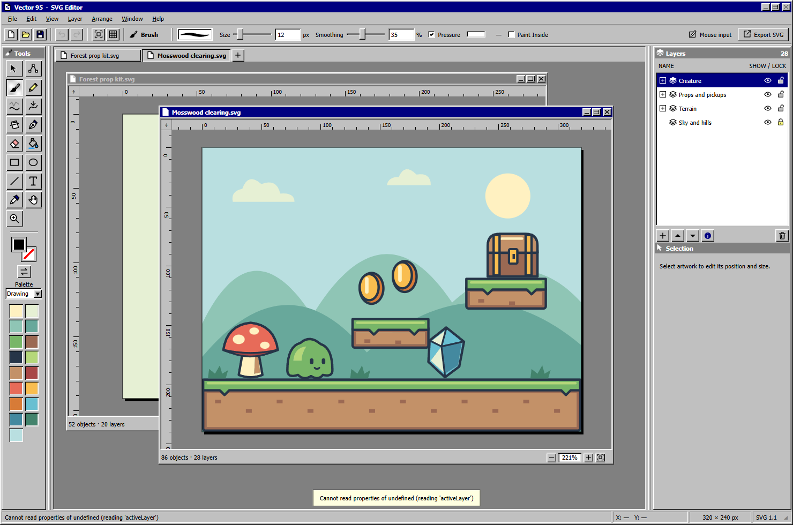

# Vector 95

A standalone, offline SVG drawing app for simple game art, with pressure-sensitive ink and a compact Windows 95/98 MDI workspace.



## Release status and running the app

Double-click **`release/Vector95-1.4.2.exe`** to run the portable Windows app. No installation or Node.js is needed. The unpacked app is also available at **`release/win-unpacked/Vector 95.exe`**; keep that folder together. Current build verification is recorded in `TASKS.md`.

The latest text-tool build is **`release/text-stroke-build/Vector95-1.4.2.exe`**, with text fill/stroke controls, searchable installed fonts displayed in their own typefaces, named styles, live SVG preview, editable text baselines and text-to-path conversion/export. The unpacked app is at **`release/text-stroke-build/win-unpacked/Vector 95.exe`**. Close your current editor before launching this build, since subsequent launches normally restore the existing instance.

The latest ergonomics build is **`release/ergonomics-build/Vector95-1.4.2.exe`**, with Primary/Secondary mouse painting, remappable shortcuts and modifiers, selection set operations, Paint Inside, visible-layer Bucket boundaries and live Preview. Its unpacked app is at **`release/ergonomics-build/win-unpacked/Vector 95.exe`**.

The latest startup fix is **`release/startup-instance-fix-build/win-unpacked/Vector 95.exe`**, including the worker-based sculpting changes. Further launches restore the existing editor instead of starting another process against the same profile database. Multiple independent copies previously caused a roughly six-second stall on the first saved-preference read. Save and close all older builds before launching this build for the first time; older builds do not acquire the new instance lock. Normal launch, duplicate launch, GPU/WASM loading, native editing/file operations and window restoration have been checked.

The app records its latest startup timings in `%APPDATA%/vector95/startup-timing.json`. `scripts/normal-startup-smoke.ps1` measures a normal launch using an isolated copy of saved settings, without a debugger. Pass `-CompetingInstance` to verify that a second launch reuses the first editor.

The build with **Aseprite-compatible shortcuts** is **`release/aseprite-shortcuts-build/Vector95-1.4.2.exe`**, including Help search, transform feedback, painting ergonomics and sculpting. Its unpacked app is at **`release/aseprite-shortcuts-build/win-unpacked/Vector 95.exe`**.

The latest build with **Help command search and transform feedback** is **`release/search-transform-build/Vector95-1.4.2.exe`**. It includes the painting ergonomics, sculpting and spring-loaded tools above. Its unpacked app is at **`release/search-transform-build/win-unpacked/Vector 95.exe`**.

The latest trial build is **`release/smooth-responsive-build/Vector95-1.4.2.exe`**, with faster Smooth gestures and automatic geometry cleanup, Nudge Strength, spring-loaded tool keys, Slice, painting ergonomics, Help command search and transform feedback.

The latest local build with **Canvas Size in Document Setup** is **`release/canvas-build/Vector95-1.3.2-canvas.exe`**. Packaged crop/expand/Crop to Selection, Undo/Redo, native save/open/export, and portable extraction/launch/exit passed. Its unpacked app is at **`release/canvas-build/win-unpacked/Vector 95.exe`**.

The app starts with a blank drawing. **Help → Example Drawings** opens **Mosswood clearing**, a small platformer scene, or **Forest prop kit**, a matching set of editable game assets. Each drawing has its own layers, zoom, pan, and up to 100 undo steps.

Drag document title bars and resize from any edge or corner. **Window → Tile Vertically / Tile Horizontally / Cascade Windows** arranges the workspace. Minimised captions can be moved; double-click restores their previous size and position. Maximised drawings share the main frame controls. Window placement survives session recovery. **Ctrl+Tab / Ctrl+Shift+Tab** or **Ctrl+F6 / Ctrl+Shift+F6** cycles drawings; **Ctrl+F4** closes the active drawing.

## One layer tree

The **Layers** list is the drawing's complete hierarchy. A layer holds its own paint, lines, and text, and can contain child layers. The list shows frontmost siblings first. On the canvas, child layers draw first, then the parent's own paint, then its lines and text. Lines and text stay above paint on the same layer.

Layers stays at the top of the sidebar while Tool Options and Selection scroll below it. Drag the divider beside the sidebar to adjust its width; the app remembers the width. When the divider has keyboard focus, Left and Right adjust it in 10 px steps.

Click a layer name to choose where to draw. **Ctrl-click** a layer name selects its own contents; **Layer → Select Layer Contents** does the same for the active layer. **Ctrl+A** selects editable artwork within the active layer. Expand or collapse branches with the small plus/minus controls. Parents of a newly chosen nested drawing layer open automatically.

**Show** and **Lock** control visibility and editing. A hidden or locked parent also affects its descendants. Double-click a layer name, or choose **Layer → Layer Properties**, to change its name, export ID, and opacity. Layer opacity applies to the layer and its descendants together. Export IDs must be unique; changing an ID updates its references.

Use **Layer → New Layer** to add a sibling above the active layer. **Layer → Selection to New Layer** (**Ctrl+Shift+J**) moves selected artwork into a new layer without changing its page position. Separate layers keep paint from joining or cutting each other. Drag a layer name above or below another row to reorder it, or onto the middle of a row to nest it. The drop indicator shows the destination. Reparenting preserves the artwork's page position. **Move Up / Move Down** changes order among siblings.

**Layer → Flatten** combines visible content in the active layer and its descendants into paint. It supports solid vector paint and lines, baking outlines into filled geometry while preserving transparency and blending colors where translucent layers overlap. Nested child-layer opacity applies to each child's combined contents; the active layer keeps its own opacity. Hidden layers are retained with their inherited transparency, and Undo restores the prior structure. Editable text, images/references, gradients, and clips/masks are not supported by Flatten; the command leaves the drawing unchanged when those effects prevent a faithful result. Keep such content on separate layers.

The blazer import fixture has exactly two root layers: **Body reference (show to align)** and **Clothing**. The reference starts hidden and locked. Clothing's **Paint** child is initially active and accepts Brush paint immediately; there is no conversion step before painting. Decorations on the parent remain above the paint.

## Tools and shortcuts

| Tool                       | Key             | Behaviour                                                                                                                                          |
| -------------------------- | --------------- | -------------------------------------------------------------------------------------------------------------------------------------------------- |
| Selection                  | V / M           | Click artwork to select it and activate its layer; marquee selects within the active layer. Move, resize, or rotate the selection. Shift adds.     |
| Node Edit                  | A               | Edit path anchors and handles; insert/delete anchors and choose corner or smooth points.                                                           |
| Brush                      | B               | Pressure-sensitive vector paint. Matching fills join; another colour cuts underlying paint on the same layer.                                      |
| Pencil                     | Y               | Draw constant-width lines fitted to editable Bézier curves on release.                                                                             |
| Nudge                      | N               | Push lines and filled contours with a soft brush. Large sizes make broad bends; small sizes make local corrections.                                |
| Smooth                     | S               | Left-click or drag softens bumps in lines and filled contours. Right-click or drag sharpens existing detail.                                       |
| Slice                      | K               | Cut paint and lines into independent pieces. Size 0 splits Pencil, Line, and unfilled paths without removing length.                               |
| Pen                        | P               | Click for corners, drag for curve handles, Enter to finish, or click the first anchor to close. Backspace removes the last anchor; Escape cancels. |
| Eraser                     | E               | Erase paint locally on the active layer.                                                                                                           |
| Paint Bucket               | G               | Fill a connected area with Primary or Secondary; choose active-layer or visible-layer boundaries in Tool Options. None clears paint.               |
| Rectangle / Ellipse / Line | U / Shift+U / L | Drag to draw. Shift constrains proportions or line angles.                                                                                         |
| Text                       | T               | Add editable text; double-click text to edit its words and font.                                                                                   |
| Eyedropper                 | I               | Sample a solid SVG colour. Shift samples an outline; Alt-click temporarily samples with Brush or Pencil.                                           |
| Hand                       | H               | Pan the drawing. Space temporarily activates Hand.                                                                                                 |
| Zoom                       | Z               | Click to zoom in; Alt-click to zoom out.                                                                                                           |

**Ctrl+wheel** zooms at the pointer. **Ctrl+0** fits the artboard; **1** or **Ctrl+1** restores 100%. **Ctrl+plus / Ctrl+minus** zoom; **plus / minus** adjust brush size without changing selected artwork. Arrow keys nudge by the configured step; Shift moves ten steps. **Ctrl+Alt+F** flattens the selected layer. **Ctrl+D** deselects; **Ctrl+Alt+D** duplicates, **Ctrl+C/X/V** copies/cuts/pastes, **Ctrl+Z** undoes, and **Ctrl+Shift+Z** redoes. **Ctrl+S** saves; **Ctrl+Shift+S** saves as. **?** shows shortcuts. Use the **Layer** menu for layer operations and **Arrange** for ordering, flipping, and curve conversion. Menus support Alt mnemonics and arrow-key navigation.

Other command defaults: **Shift+N** adds a layer; **F2 / Shift+P** opens layer properties; **Shift+H / Shift+V** flips selected artwork; **Shift+S** toggles grid snapping; **Ctrl+Shift+W** closes all drawings; **Ctrl+Alt+Shift+S** exports an SVG copy.

Left-drag uses **Primary**, and right-drag uses **Secondary**. With Brush, Pencil, Line and Paint Bucket, choosing **None** clears artwork. For Rectangle, Ellipse and closed Pen paths, left uses Primary fill and Secondary border; right swaps them. Open Pen paths use the chosen mouse button's colour. The colour picker has an explicit None button. **X** swaps Primary and Secondary. Tool shortcuts and Space panning remain available after adjusting toolbar sliders or checkboxes. Text and number fields retain their normal editing keys.

**Spring-loaded tool keys:** tap any tool shortcut to switch permanently, or hold it for 200 ms to use that tool temporarily. Using it on the canvas also makes it temporary, even for a quick dab. Release to return to the previous tool; if a stroke is still running, it finishes before the tool returns. For example, hold **E** to erase, **S** to smooth, or **N** to nudge. Remapped shortcuts work the same way. Temporary switches preserve the selection and an unfinished Pen path; a toolbar choice overrides the held key. **Space** continues to pan while held.

Selection uses the same set operations for clicks and marquees: **Shift** adds, **Alt+Shift** or the **right mouse button** subtracts, and **Ctrl+Shift** intersects. **Edit → Reselect** (**Ctrl+Shift+D**) restores the previous selection, and **Edit → Invert Selection** (**Ctrl+Shift+I**) selects its complement within the active layer. Hidden and locked artwork is excluded. Hold **Ctrl before starting a selection drag** to copy it; the original stays in place and the gesture is one Undo step. Releasing Ctrl during the drag continues moving the copy. Escape cancels, including while Ctrl remains held. While moving, **Alt** temporarily enables grid snapping when it is off, or bypasses it when it is on; the global setting stays unchanged.

**Edit → Preferences** (**Ctrl+K**) remaps tools, commands and contextual modifiers. **Ctrl+Alt+Shift+K** opens shortcut settings directly. Search by name, enter a chord such as Ctrl+K or Space, leave a field blank to unassign it, or separate command alternatives with commas. Conflicts within a context must be resolved before Apply. Cancel discards edits; Restore Defaults resets assignments. Bindings persist across launches. Older saved defaults upgrade to the Aseprite-compatible defaults while custom assignments and deliberate unassignments are retained; custom keys take precedence if a new default conflicts. Menus, tool labels and **Help → Keyboard Shortcuts** reflect them. The keys described here are the defaults.

**Ctrl+Space** opens command search in the **Help** menu. It searches commands by name, menu path or shortcut. Results show their menu location and current shortcut; unavailable commands remain visible. **Enter** runs the first available result, arrow keys navigate, and the **→** button reveals the command in its menu without running it. **Escape** closes search.

Selection transforms show temporary feedback beside the pointer. Moving shows the actual distance and any constrained axis. Resizing marks the fixed corner or centre and shows current dimensions and proportion locking. Rotating marks the pivot and shows the angle and 15° snapping. A faint original outline remains visible during the drag, and modifier changes update the cues and artwork immediately. Feedback disappears on release or cancellation and is excluded from saved and exported artwork.

Hold **Ctrl+Alt** and drag horizontally on the canvas to adjust Brush, Pencil, Eraser or Line Size. Hold **Ctrl** to draw Rectangle/Ellipse from the centre; **Shift** constrains proportions or line angles. While drawing a shape, hold **Space** to move its origin. **Shift-click/drag** with Brush or Pencil connects the previous endpoint; additionally hold **Ctrl** for 45° increments. Escape cancels an unfinished gesture.

**View → Preview** (**F7**) opens a movable, resizable live view of the active drawing at 25%, 50%, 100% or 200%, independently of canvas zoom. It follows drawing, erasing, Undo and document changes. Close it when you do not need it.

**C** opens **File → Document Setup** with the Canvas Size width field focused. **File → Document Setup → Canvas Size** crops or expands the canvas without scaling the artwork. Enter width and height, and choose one of nine anchors to keep that point fixed; the default is Centre. Drag the preview's edges or corners to resize, or drag inside to move the canvas around the artwork. Edge handles also accept arrow keys (Shift for 10 px). Reset Size restores the original canvas. Apply commits the settings in one undo step; Cancel leaves the drawing untouched. Artwork outside the canvas is hidden and retained, so expansion can reveal it again. Save, Export SVG, and reopening preserve the dimensions and artwork position.

**File → Crop to Selection** fits a rectangular canvas around selected artwork, including selected outlines, and expands the bounds outward to whole pixels. It keeps every object and is undoable. The same button in Document Setup previews the result before Apply. Imported legacy outlines remain separate objects and must be included in the selection when needed.

## Tile and symmetry modes

Use the nested **View → Tiled Mode** and **View → Symmetry Options** menus. Each choice applies immediately, with a checkmark beside the active mode. Settings belong to each drawing and survive Save, reopening, and session recovery. Both modes can be used together.

Tile Mode offers **Off**, **X**, **Y**, and **Both**. X shows three tiles horizontally, Y shows three vertically, and Both shows nine tiles. Fit Artboard fits the repeated view. Draw, erase, sample colours, select, move, and edit nodes in any visible copy. The copies edit the same underlying artwork; they do not add documents or layers. Continuous strokes wrap across enabled edges, including corners and wide nibs. Moving painted artwork across an enabled edge wraps its completed geometry too. Save and Export contain one SVG tile, with no preview copies or guides.

Symmetry Mode mirrors drawing and erasing around a **vertical axis**, a **horizontal axis**, or **both**. Drag the square handles to reposition the axes, or use **View → Symmetry Options → Centre Axes**. Moving an axis changes subsequent gestures without moving existing artwork. Brush pressure and curve handles are reflected. Pencil, Pen, Line, and Text produce independently editable mirrored objects; paint is combined into vector regions. Editing an existing object uses the normal selection/node tools. Each complete drawing, erasing, move, or axis drag is one Undo step; Escape cancels an active mode gesture.

Lines and text crossing tile edges keep their editable source with translated, clipped vector copies. Borders on tiled shapes are separate vector outlines, avoiding artificial outlines along cut tile edges; like other lines, these outlines remain when erasing their fill. Flatten can bake repeating lines into clipped paint, while editable text retains the existing Flatten restriction. Plain SVG exports use ordinary SVG paths, transforms, and clipping and remain fully vector-based.

## Paint and erasing

**Smooth (S)** relaxes bumps in existing lines and filled contours. **Right-click or right-drag** does the reverse, sharpening existing bends and bumps. Size sets the affected area on screen, while **Strength** controls the amount. Strength is separate from drawing Smoothing; zero Strength leaves artwork intact. Select artwork first to limit the effect to the selection on its active layer. Endpoints and distant geometry stay fixed; line width, colours, transforms and holes are retained. Each gesture is one Undo step, and Escape cancels. Smooth has the same limits for text, effects and repeating objects as Nudge.

**Geometry cleanup:** Nudge and Smooth remove redundant anchors locally when you finish a gesture. Smooth also compacts each touched contour once early in the gesture. Together, these cleanup passes stay within 0.15 screen pixels at the current zoom and retain endpoints, hard corners and separate contours. Smooth can simplify an already straight but densely sampled line. Cleanup shares the gesture's Undo step; zero Strength leaves geometry untouched. Smooth reuses geometry during each gesture, skips distant artwork and updates affected shapes directly. Tiny movements accumulate into brush-spaced dabs, with the remaining movement applied on release. This reduces geometry buildup and repeated processing; complex shapes still require more work than simple ones.

The Smooth/Nudge/Slice trial build is `release/smooth-build/Vector95-1.4.2.exe`.

**Nudge (N)** sculpts Pencil/Line paths and the boundaries of filled paint and shapes. Drag on a contour to pull it, or beside it to push. Size is the brush diameter on screen (up to 500 px), so zooming in makes tighter corrections. **Strength** controls how far the contour follows your drag: the default 25% gives gentle adjustments; 100% preserves the original full movement for large distortions, and 0% leaves artwork intact. Nudge Strength is separate from Smooth Strength and drawing Smoothing. It preserves line width, fill, borders, holes, and artwork transforms. Select artwork before choosing Nudge to limit the edit; otherwise it affects the active layer. One completed gesture is one Undo step; Escape cancels. Text, effects, dashed outlines, and repeating line objects are left intact.

The Nudge/Slice trial build is `release/sculpt-build/Vector95-1.4.2.exe`; packaged sculpting, Undo/Redo, SVG recovery and portable launch/exit have been checked.

**Slice (K)** at a positive Size cuts paint and lines with the eraser footprint and separates disconnected pieces. At **Size 0**, drag across Pencil, Line, or unfilled paths to split their exact curves into independent objects without removing length. Select either piece to move or delete it. Filled paint needs a positive Size. Selection limits Slice to selected artwork on the active layer; hidden and locked layers stay protected. Undo restores the complete cut.

**Paint Bucket (F)** fills the connected area with Primary on left-click or Secondary on right-click, using that colour's opacity. It creates editable vector paint in one undo step. **Boundaries → Active layer** uses the active layer's fills and lines; **Visible layers** also uses visible reference layers, including locked references, while painting only on the active layer. Closed outlines contain a fill, while gaps let it spread to the artboard edge. Disconnected patches and holes stay separate. None clears the clicked paint component while retaining its boundary lines. Keep text, images, gradients, clips/masks, and unsupported outlines (dashed or non-scaling strokes) on separate layers; the bucket leaves unsupported artwork unchanged and reports the limitation. Hidden or locked destination layers cannot be filled.

The integrated feedback build is available in **`release/review-build/Vector95-1.4.2.exe`**. Canvas Size is under File → Document Setup.

Paint is the normal drawing behaviour. On release, touching fills of the same colour and opacity join into a vector region on the active layer. A different colour cuts its footprint out of the underlying fill, so moving the new paint away reveals a real hole. Other layers remain separate. Brush, Pencil and Line use the mouse button's chosen colour.

Enable **Paint Inside** in Brush Tool Options to recolour existing paint without extending its silhouette. Holes and each region's transparency remain intact, including transformed artwork. Brush opacity controls the colour blend; an empty layer receives no paint. The setting is optional and each stroke remains one Undo step.

Eraser removes paint and cuts lines locally. Choosing None for Secondary makes right-drag with Brush erase; a compatible pen's eraser end also erases. Diameter, pressure, and smoothing control the eraser footprint. Straight butt-capped cuts retain editable centerlines where possible; other touched strokes become editable outline boundaries and stay above paint. Untouched lines and text retain their original form. Dashed, non-scaling and effect-dependent outlines are kept with an explanation. To remove selected artwork entirely, use Delete. A colour at zero opacity does not erase; None is the explicit erasing choice.

Text supports multiple lines, blank lines and adjustable line spacing, with a live preview. Pencil smoothing preserves deliberate sharp corners. A sequence of quick or held arrow nudges shares one Undo step; a pause or another editing command starts a new step.

The app starts with a blank drawing. **Help → Example Drawings** opens either example and offers an optional preference to open both at startup. Saved session recovery takes precedence over this preference.

Duplicate and Paste select the new copy without merging it into the original. Drag and release to place it, or press Enter or click elsewhere to place it where it is. Arrow-key nudges and numeric adjustments can position a new copy before placement. Save and export do not place it.

For placed artwork, each completed drawing, drop, numeric transform, or sequence of arrow nudges commits its geometry operation and is one undo step. Changing tools or layers does not trigger another cut. Saving and exporting wait for operations already queued. The status bar reports pending work; panning remains available while dependent edits wait.

The live brush preview follows the pointer while completed ink becomes SVG paths. Paint joining, cutting, and contour fitting run in a background worker. Merged paint keeps its final contours; changing brush Size does not reconstruct individual strokes. Pencil lines retain editable paths and do not join at intersections. Imported solid fills become paint on their layer without an extra command, while their outlines remain visible above paint.

Mirrored/tiled brush and eraser previews stream small SVG ink chunks and reuse them through transforms. Long strokes update only new ink, without rebuilding the canvas or copying all previous samples. Overlapping mirrors apply opacity once. `node scripts/mode-benchmark.mjs` measures input handling and worker finishing against a running preview (`VECTOR95_PORT` selects its port); results are saved in `artifacts/drawing-modes/mode-benchmark.json`.

## Colour, curves, and text

The toolbox and colour picker keep **Classic (Arne16)**, **Drawing**, and **Recent** palettes at the top, followed by a separator and the other 63 palettes from [Aseprite's extensions](https://github.com/aseprite/aseprite/tree/main/data/extensions), sorted by name. Each palette name has a miniature colour preview beneath it, with larger palettes wrapping across rows. Palette credits and source links are in [src/palette-credits.txt](src/palette-credits.txt). Drawing colours include all nested layers. Drag the toolbar's right edge to resize it; tools and swatches reflow and the width is remembered. Left-click chooses **Primary**; right-click chooses **Secondary**. The colour chips open a precise picker with hex colour and opacity. These tool colours apply to new artwork, even when existing artwork is selected. Selecting artwork leaves Primary and Secondary unchanged. Use the selection's **Fill colour**, **Border colour**, or **Stroke colour** control to recolour existing artwork. Sampling with Eyedropper changes Primary without recolouring a selection. Bitmap pixels and gradients are not sampled.

New rectangles and ellipses use Primary for their fill and Secondary for an attached border, with the toolbar Size as its width. With a shape or painted region selected, use the main toolbar to set its fill and border colour, and drag the border size slider. A border size of zero removes the border. These borders follow the remaining contour after cuts and erasing, and never change paint intersections. Unbordered brush paint joining a bordered region inherits its border; an explicitly bordered incoming shape supplies the resulting border. Normal saves preserve editable borders, and plain SVG exports draw them as SVG strokes. Imported legacy outlines remain separate artwork; Flatten deliberately bakes all visible borders into paint.

The main toolbar shows the active tool's options: **Size**, **Smoothing**, **Pressure**, and a stroke preview where applicable. Size and smoothing have sliders and editable numeric values. Options wrap onto a second row in narrower windows. **Size** controls brush diameter and line width. The selection inspector shows position and geometry dimensions in page coordinates. **Arrange → Convert to Curves** makes shapes available for anchor editing. Pencil lines are fitted before editing to keep their anchor count manageable. In Node Edit, choose Corner or Smooth, insert/delete anchors, or drag handles. Alt-drag breaks a smooth handle's link.

Drag the round selection handle to rotate; Shift uses 15° steps. **Lock aspect ratio** applies to resizing and width/height fields. Alignment controls align multiple selected parts to their combined bounds, or one part to the artboard. These edits remain undoable.

The text dialog searches installed font families and offers their named styles. Family names appear in their own typefaces, including the selected name and search results. Recent families appear first; typing a search leaves the chosen font unchanged until you select a result. The desktop app loads installed fonts automatically; the browser preview has an **Installed fonts** button. Missing families and unavailable styles are identified inline.

With text selected, the toolbar offers **Fill**, **Stroke**, and **Stroke size**. Each colour picker has its own opacity and **None** option; no fill gives outline-only lettering. Choosing a stroke colour starts at 1 px when no stroke is visible, and the size slider previews before committing one Undo step. Set its size to zero or choose None to remove it. Straight and curved lettering remain editable SVG text.

Typography changes preview as SVG both in the dialog and on the artwork. Drag the dialog title bar out of the way; switch the preview to a dark background for pale lettering. Explicit newlines, spacing, outlines and imported styled runs are rendered using the artwork's SVG. Apply creates one Undo step; unchanged Apply, Cancel, Escape and the black close button leave the drawing unchanged. Editing words preserves neighbouring styled spans and their IDs.

Select one single-line text object and one continuous curve, line, ellipse or rectangle, then choose **Arrange → Attach Text to Path**. The text owns an editable copy of the curve; the original artwork stays in place. **Edit Text** adjusts position along the path, baseline offset and direction. **Edit Text Path** exposes the baseline's nodes and handles. Moving or scaling the text also transforms its baseline. **Detach Text from Path** makes the lettering straight at its first baseline position. These operations support Undo, and curved text exports as native SVG `textPath` with its own path definition.

**Arrange → Convert Text to Paths** creates node-editable letter outlines using the installed font face. **Export SVG → Convert text to paths in the exported copy** makes lettering independent of installed fonts while retaining editable text in the working drawing. Both operations preserve supported kerning, ligatures, line spacing and curved placement. Outlining currently rejects mixed-format imported runs, complex scripts/combining marks, colour glyphs, variable or condensed/expanded faces, missing font faces and advanced per-character positioning rather than changing their appearance. Such content can still be edited and saved as text. Converted letters retain their stacking as standalone vector artwork; Flatten can combine them with a layer's paint.

## Pixel precision and export

**View → Grid Settings** sets grid spacing, arrow-key step, and pixel-edge or half-pixel alignment. Half-pixel placement helps odd-width outlines remain crisp. Hold Alt to bypass snapping. The grid gains finer divisions as you zoom in. Brush and Pencil strokes remain unsnapped.

Selection dimensions describe geometry without outlines. **Export SVG** can use the artboard or fit selected artwork, including outlines or only geometry. The dialog reports exact dimensions and can expand selection bounds to whole pixels without rounding the artwork's curves. Export creates a copy without changing the working filename, path, or unsaved state. Plain SVG omits editor metadata while retaining artwork and required definitions.

Opaque paint uses **swallow seam filling**: each lower region receives hidden backing inside later opaque neighbours that share an edge. The canvas, Save, Export, and flattened artwork use the same policy. Editable paths, cutouts, selection bounds, outer silhouettes, and transparent holes stay exact; isolated shapes receive no padding. Backing is cached until the layer's artwork changes. Real borders, translucent shapes, clips/masks, and individually referenced objects are left alone. Swallow favours speed and can produce a small colour fringe at contrasting antialiased outside edges.

Every saved/exported SVG records the producing app version (`data-vector95-version`) and an independent file format version (`data-vector95-format`, currently **4**). Editor metadata keeps the canonical geometry. Plain exports omit the document record but retain source geometry and a change-detection tag on repaired paths, so reopening restores cutouts before regenerating backing. Named opaque paint stays on its exported layer. Loading formats 1–3 upgrades the rendering policy; unchanged generated format-3 strokes are removed, while real borders, externally edited geometry/strokes, and unknown tags remain artwork. Flatten combines exact paint and real outlines without baking generated padding. Format 4 also stores drawing-mode settings and editable periodic lines/text; older documents start with modes Off.

## Files and recovery

The desktop **File** menu lists the four most recently opened or saved drawings above **Exit**, with underlined numbers in the Windows 95 style. Press **Alt+F**, then **1–4** to reopen one. The list survives restarts; selecting an already-open drawing brings its window forward. Long paths are shortened in the menu, with the full path in the tooltip and status bar.

Open SVGs through the native file dialog, drag-and-drop, or browser upload. Save and Save As write ordinary SVG with vector geometry, text, recursive layers, and Vector 95 editing metadata. Reopening restores the editable layer hierarchy and stable IDs. Imported SVG containers become layers; transforms, stacking, names, and references are retained. Solid fills support immediate painting. Lines and text remain separate editable content within their layer.

In the standalone app, Save writes back to the original SVG, including drawings opened by drag-and-drop. Save As lets you choose a different file; new drawings ask for a location on their first Save. Browser Save downloads the SVG.

Gradients, masks, clipping paths, and embedded images can be retained on import, but have limits for destructive paint operations and Flatten. Active content, external resources, embedded CSS stylesheets, and SVG filters are removed or unsupported. Opening CSS-class or stylesheet artwork displays an appearance warning; convert those styles to inline styles or presentation attributes for faithful import. Large imports prepare their geometry in a worker so the interface can keep responding.

Local session recovery protects unfinished work. A normal exit asks to save dirty drawings and clears the recovery workspace; intentionally discarded changes do not return. SVG files remain the durable saved drawings. The desktop renderer is sandboxed and uses a narrow isolated bridge for native file dialogs and window controls. The app works offline.

## Tablet input

Enable **Pressure** in the main toolbar for Brush. Pressure changes the stroke width; the live meter shows input received from the device. Mouse and touch use constant width. A compatible pen's eraser end erases paint locally. Brief touch suppression after pen input helps reject palms.

The tablet driver must expose pressure through Windows Ink. Automated checks use simulated pen input; physical tablet validation remains outstanding. Tilt, multitouch gestures, and Wintab-only drivers are not implemented.

## Develop

Requires Node.js 22+ on Windows.

```sh
npm install
npm start
```

For a browser preview, run `npm run preview` and open `http://127.0.0.1:5173`. Browser upload/download replaces native file dialogs.

### Editing the app's SVG assets

The source artwork lives in `src/assets/`: `icons/` contains toolbar and menu icons, `captions/` contains window controls, `scrollbars/` contains the arrows, `examples/` contains the two sample drawings, and `favicon.svg` contains the application icon. Open these files in Vector 95, edit them, and save back to the same file. Keep a transparent background for icons. Icons use `currentColor` where they should follow the interface's text colour; import and save preserve that token. Caption glyphs use a 12 × 10 viewBox; other interface icons use 16 × 16.

`npm run build:assets` is the standalone asset build. It validates and minifies the SVGs into a JavaScript catalog, bundled scrollbar CSS, and a favicon under `src/generated/`. It preserves geometry precision, references, and the example drawings' editor metadata, and leaves the source SVGs untouched. Generated files are ignored by Git. Installation, desktop startup, tests, and packaging generate them automatically; browser preview also picks up saved SVG changes when you reload. To launch Electron directly after changing an asset, first run `npm run build:assets`.

Desktop packaging also regenerates the Windows `.ico` from the SVG favicon using Chrome (`VECTOR95_BROWSER` overrides the executable), then packages the generated assets for offline use. Editable SVG sources stay in the repository and are excluded from the packaged app.

```sh
npm test
npm run test:ui
node scripts/desktop-smoke.mjs
npm run build
node scripts/desktop-smoke.mjs --packaged
node scripts/drawing-modes-smoke.mjs --packaged
node scripts/portable-smoke.mjs
```

Interface checks use Chrome by default. Set `VECTOR95_PORT` for an isolated preview/test port and `VECTOR95_BROWSER` for another Chromium executable. Native smoke checks use temporary profiles and output in `.cache/` and `artifacts/`. `npm run build:dir` produces only the unpacked desktop app.

The implementation uses plain JavaScript modules and SVG. `src/core.js` handles documents, history, and export; `src/hierarchy.js`, `src/layer-ops.js`, and `src/layer-ui.js` handle recursive layers; `src/paint.js` and `src/paint-worker.js` handle paint geometry; `src/ink.js` and `src/brush-preview.js` handle ink and live feedback; `src/stroke-geometry.js` converts outlines into filled geometry for Flatten. Import lives in `src/svg-io.js` and `src/svg-import.js`; `src/app.js`, `src/menus.js`, and `src/classic.css` provide the tools and MDI interface. `src/text-dialog.js`, `src/fonts.js`, `src/text-path.js` and `src/text-outline.js` provide typography. `electron/` contains the desktop shell. Paper.js and Fontkit are bundled locally under MIT licences. Application JavaScript runs directly as modules; preparation compiles the SVG assets and bundles Fontkit for offline, on-demand outlining.

Current work and historical verification are recorded in [TASKS.md](TASKS.md). This is a static vector editor; animation and authoring reusable symbols are not included.
